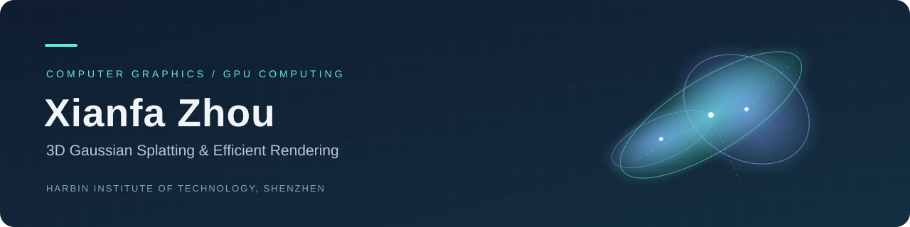

  

<h1 align="center">Xianfa Zhou</h1>

  <b>Ph.D. Student · Computer Science and Technology</b> 
  Harbin Institute of Technology, Shenzhen

  <a href="https://github.com/Mrzhouxf?tab=repositories">Repositories</a>
  &nbsp; / &nbsp;
  <a href="https://github.com/Mrzhouxf/3dgs-research-paper">3DGS Research</a>

---

### About Me

I am currently pursuing a Ph.D. in **Computer Science and Technology** at **Harbin Institute of Technology, Shenzhen**.

My research focuses on **accelerating 3D Gaussian Splatting (3DGS)**. I am interested in how algorithm design and GPU execution interact, and in improving rendering efficiency while preserving visual quality.

### Research Interests

| Area | Focus |
| :--- | :--- |
| **3D Gaussian Splatting** | 3D scene representations, training, and rendering |
| **Efficient Rendering** | Accelerating rendering and backpropagation; balancing quality and efficiency |
| **GPU Computing** | Parallel execution, memory access, and performance bottlenecks |

### Education

**Harbin Institute of Technology, Shenzhen**  
Currently pursuing a Ph.D. in Computer Science and Technology

### Research & Code

I use GitHub to organize research code and reading notes, connecting paper analysis with implementation details and performance optimization.

- **[3DGS Research](https://github.com/Mrzhouxf/3dgs-research-paper)** — My 3D Gaussian Splatting research repository
- **[All Repositories](https://github.com/Mrzhouxf?tab=repositories)** — Explore my public projects

---

  Understand the method. Examine the implementation.

